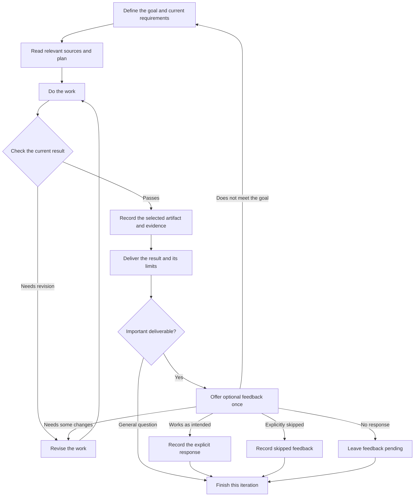

# AI-assisted Workflow

A practical, file-based approach to working with AI across study, research, projects, and everyday tasks.

When you work on several topics with an AI assistant, it can be hard to find the latest requirements, identify the right file, or pick up where you left off. AI-assisted Workflow provides a way to organize that information so you and your assistant can resume work from readable files.

This repository contains guides, fictional examples, an instruction template, and small Python tools. Start with one task and adopt only the parts that help you.

## What you can use it for

- **Learning and exam preparation:** keep source material, explanations, practice questions, and review notes organized by subject.
- **Reports and assignments:** distinguish the current requirements, original sources, drafts, and reviewed deliverables.
- **Projects and experiments:** define a goal, compare iterations, and record what changed and how it was checked.
- **Research and personal interests:** connect useful explanations to their sources and keep track of open questions.

The approach works with assistants that can read the workspace files you make available to them. Each assistant keeps its own conversation history, account settings, permissions, and tools. Shared files provide continuity; they do not automatically synchronize chats or grant access to another app.

## How it works

Understand the task, read the relevant sources, do the work, and check the result against the current requirements. Record enough context for the next session to continue.



Choose checks that fit the work: inspect calculations, run relevant code tests, compare a report with its brief, or review the rendered document. If the requirements or selected file change, check the new version again. A previous review should not make a changed result appear ready.

After an important deliverable, the user may choose **Works as intended**, **Needs some changes**, or **Does not meet the goal**. Feedback is optional and separate from verification. Acceptance does not prove a submission occurred or authorize an upload, model run, or other external action.

If the user explicitly skips feedback, record it as `skipped`. If they do not respond, leave it `pending` without sending automatic reminders.

## Start with your own work

1. Choose one active task, such as a report or a small project.
2. Identify its current goal, requirements, original sources, and next action.
3. Keep originals, notes, drafts, and reviewed outputs distinct. Existing project folders can stay where they are.
4. Give your assistant access to the relevant files and ask it to work from that context.
5. Save confirmed corrections, the selected artifact, and meaningful verification evidence before handing off the task.

Browse the [example workspace](examples/README.md), then adapt the [assistant instruction template](templates/AGENTS.example.md) for your own workspace. The example course identifiers are illustrative; replace them with your own subjects or project names.

For example:

```text
Read the task brief and relevant source files in this folder.
Summarize the current requirements and propose a report outline.
Write a clear draft, then check it against the requirements.
Preserve the original sources, identify the current output file,
and record any unresolved questions or limitations.
```

You can also keep reusable notes in a shared knowledge folder or an Obsidian vault while leaving project files in place. The [shared knowledge guide](docs/shared-knowledge.md) explains how to separate work, study, and general notes without replacing the projects' own current state.

## Try the examples

Download and extract the repository using **Code > Download ZIP**, or clone it:

```sh
git clone https://github.com/panithan1991/ai-assisted-workflow.git
cd ai-assisted-workflow
```

Use **Python 3.10 or later**. From the repository root, run:

```sh
python -B tools/check_blueprint.py
python -B -m unittest discover -s tests -v
python -B tools/demo_workflow.py
```

Use `python3` instead of `python` if that is how Python is installed on your system. These commands use the Python standard library; no additional packages, AI account, API key, or model download are required.

- The checker validates example metadata, references, documentation links, and the repository's publication checks.
- The tests exercise workflow and feedback invariants, including stale verification and invalid state changes.
- The demo creates fictional files in a temporary directory and replays a task from draft through revision, review, and a simulated submission confirmation. It does not submit anything or run a model.

An `EXPECTED REJECTION` message in the demo means a guard worked as intended, such as rejecting an artifact changed after review. See the [step-by-step walkthrough](docs/walkthrough.md) for the expected sequence.

## Explore the design

| Guide | What it covers |
|---|---|
| [Workflows](docs/workflows.md) | Learning, projects, document work, and resuming a task |
| [Adoption plan](docs/adoption-plan.md) | Introducing the approach into an existing workspace |
| [Verification and feedback](docs/feedback-loop.md) | Checking work, collecting optional feedback, and revising |
| [Architecture](docs/architecture.md) | How instructions, context, files, and evidence fit together |
| [Shared knowledge](docs/shared-knowledge.md) | Keeping connected notes across work, study, and general interests |
| [Data contracts](docs/data-contracts.md) | The example metadata and validation rules |
| [Design decisions](docs/decisions.md) | Reasons behind the main choices |
| [References](docs/references.md) | Related official documentation |

This is a workflow blueprint, not an installed assistant service. It does not continuously capture conversations, train a model, synchronize apps, or assess whether a learner has mastered a subject. Those claims require separate systems and evidence.

## License

Released under the [MIT License](LICENSE). You may use, modify, and redistribute it, including commercially, subject to the license terms and retention of its copyright and permission notice.
