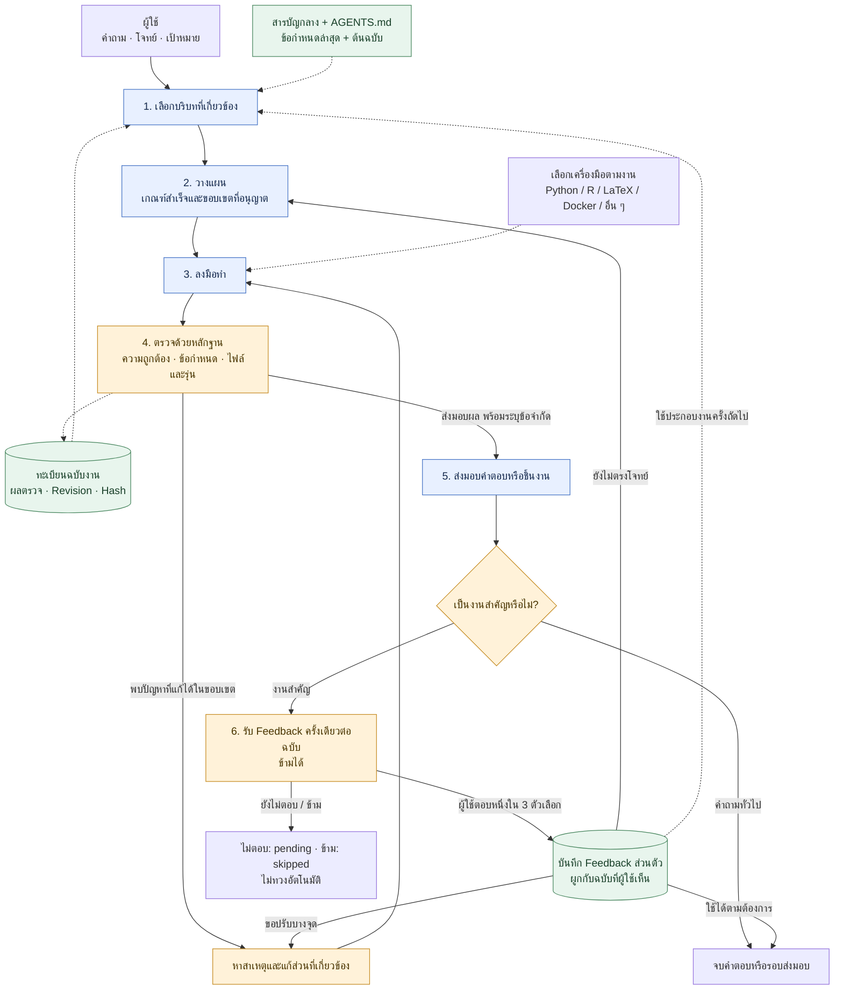

# AI-assisted Workflow

แนวทางจัดพื้นที่ทำงานร่วมกับ AI สำหรับการเรียน โปรเจ็ค และงานทั่วไป

This repository documents a file-based workflow for working with AI across learning, projects, and everyday tasks. The runnable examples focus on coursework: context, execution environments, original materials, revisions, and submission artifacts.

**สถานะ:** ต้นแบบที่นำหลักการจัดสารบัญ สถานะล่าสุด และการตรวจฉบับงานไปใช้ในพื้นที่ทำงานส่วนตัวแล้ว ชุดนี้แยกออกมาเพื่อแบ่งปันเฉพาะเอกสาร โค้ด และข้อมูลจำลอง ไม่มีไฟล์งานจริงหรือการตั้งค่าของเจ้าของพื้นที่

ผู้เรียนหรือผู้ช่วย AI ใช้ index เลือกอ่านบริบทที่ตรงงาน แล้วตรวจข้อกำหนดและไฟล์ก่อนใช้สถานะพร้อมส่ง ตัวตรวจไม่ทำงานเบื้องหลัง ไม่ฝึกโมเดล และไม่เชื่อมความจำข้ามแอปอัตโนมัติ

สำหรับชิ้นงานสำคัญ มี [วงจรตรวจงานและ Feedback](docs/feedback-loop.md): กำหนดเกณฑ์ → ทำงาน → ตรวจ → ส่งมอบ → รับความเห็น 3 ตัวเลือก → แก้และตรวจใหม่เมื่อจำเป็น ข้ามการตอบได้ และไม่ถามหลังคำถามทั่วไป ความเห็นผู้ใช้แยกจากผลตรวจและการอนุญาตทำงานเสมอ

## เริ่มทดลองในไม่กี่คำสั่ง

เปิดเทอร์มินัลในโฟลเดอร์ชุดนี้ ใช้ Python 3.10 ขึ้นไป ไม่ต้องติดตั้งแพ็กเกจหรือเข้าสู่ระบบบริการใด:

```sh
python -B tools/check_blueprint.py
python -B tools/demo_workflow.py
python -B -m unittest discover -s tests -v
```

- คำสั่งแรกตรวจสารบัญ รายการโปรเจ็ค สถานะตัวอย่าง และลิงก์เอกสาร
- คำสั่งที่สองสาธิตรับโจทย์ → สร้างงาน → ตรวจ → แก้โจทย์ → ตรวจใหม่ → จำลองยืนยันส่ง โดยใช้ไฟล์ชั่วคราวและไม่แก้ตัวอย่างใน repository
- คำสั่งที่สามทดสอบกรณีผิดพลาดที่อาจทำให้เลือกงานผิดฉบับ

อ่าน [ตัวอย่างทีละขั้น](docs/walkthrough.md) ควบคู่กับผลที่พิมพ์ออกมา คำว่า `EXPECTED REJECTION` หมายถึงตัวตรวจหยุดกรณีที่ควรหยุด ไม่ใช่การติดตั้งล้มเหลว

## ปัญหาที่ต้องแก้

- เปิดแชตใหม่แล้วต้องเล่าบริบทเดิมซ้ำ หรืออ่านประวัติยาวเกินจำเป็น
- ข้อกำหนดเก่าปะปนกับคำแก้ไขล่าสุด และมี PDF หลายฉบับจนเลือกไฟล์ส่งผิด
- Python ใน PATH กับ Kernel ของ Notebook เป็นคนละ environment
- ใช้เครื่องมือ AI หลายตัวโดยไม่มีผู้รับผิดชอบงานและไฟล์ที่ชัดเจน
- สำรองหรือย้ายงานพร้อม dependency และ cache ขนาดใหญ่โดยไม่จำเป็น

## ภาพรวม

ผู้ช่วย AI เป็นผู้ประสานงาน เลือกอ่านบริบทที่จำเป็น วางแผน และเรียกเครื่องมือตามงาน แผนภาพแสดงขั้นตอนที่ใช้ร่วมกันในแชตและไฟล์ โดยมีเครื่องมือตรวจรองรับบางส่วน ไม่ใช่บริการที่เปิดทุกแอปและรันทุกขั้นเองตลอดเวลา



ลูกศรทึบแสดงลำดับงาน เส้นประแสดงการอ่านหรือบันทึกข้อมูล คำถามทั่วไปจบที่คำตอบโดยไม่ถาม Feedback ส่วนงานสำคัญให้ตอบหรือข้ามได้ครั้งเดียวต่อฉบับ

- **ตรวจงาน:** ใช้หลักฐานตามประเภทงาน เช่น คำนวณซ้ำ รันทดสอบ ตรวจหน้าเอกสาร หรือตรวจลิงก์และแฮช หากยังไม่ผ่านหรือยังไม่ได้ตรวจ ต้องบอกไว้ การรายงานผลพร้อมข้อจำกัดไม่ได้หมายความว่างานพร้อมส่ง
- **Feedback:** บันทึกทั้งสามตัวเลือกกับฉบับที่ผู้ใช้เห็น แยกจากทะเบียนผลตรวจ ไม่มีคำตอบคง pending ไม่ถือว่ายอมรับงาน และไม่ทวงซ้ำอัตโนมัติ
- **แก้ไขและตรวจใหม่:** ถ้าเปลี่ยนโจทย์ให้เพิ่มรุ่นข้อกำหนด ถ้าแก้ชิ้นงานให้เพิ่มรุ่นผลงาน แล้วตรวจส่วนที่เกี่ยวข้องใหม่ ความเห็นฉบับเก่ายังเป็นประวัติ แต่ไม่รับรองฉบับใหม่
- **ขอบเขตการอนุญาต:** การเลือกใช้ได้ไม่เปลี่ยน failed เป็น passed ไม่ยืนยันว่าได้ส่งงาน และไม่อนุญาตรันโมเดล อัปโหลด หรือเผยแพร่แทนผู้ใช้

รายละเอียดอยู่ใน [Architecture](docs/architecture.md), [วิธีทำงาน](docs/workflows.md) และ [วงจรตรวจงานและ Feedback](docs/feedback-loop.md)

## หลักการ

1. เก็บต้นฉบับแยกจากไฟล์ที่ทดลองและแก้ไข
2. มีข้อกำหนดปัจจุบันเพียงชุดเดียวต่อหนึ่งงาน
3. รันด้วย environment ที่ระบุชัดเจน ไม่อาศัยคำสั่ง python จาก PATH โดยไม่ตรวจ
4. สถานะพร้อมส่งต้องมีไฟล์และหลักฐานตรวจ ส่วนสถานะส่งแล้วต้องมีหลักฐานการส่ง
5. เครื่องมือ AI รับหน้าที่ตามงาน และมีผู้แก้ไฟล์หลักเพียงตัวเดียวในเวลาเดียวกัน
6. ใช้โฟลเดอร์เดิมต่อได้ การรับแบบแปลนไปใช้เริ่มจากเพิ่มสารบัญและข้อมูลกำกับ
7. JSON เก็บข้อมูลให้ผู้ใช้และเครื่องมืออ่านตามกติกา ไม่ได้ทำให้ทุกแอปอ่านหรือซิงก์กันเอง

## ส่วนที่ใช้งานได้และขอบเขต

| ส่วน | สถานะในชุดนี้ |
|---|---|
| สารบัญรายวิชา งาน และโปรเจ็ค | ตัวอย่างพร้อมตัวตรวจเส้นทาง โดยไม่ย้ายโปรเจ็คเดิม |
| ข้อกำหนดและฉบับงาน | ตรวจ revision และ SHA-256 ของข้อกำหนดกับไฟล์จริง |
| หลักฐานตรวจ | อ่าน JSON และตรวจว่าผ่านสำหรับข้อกำหนดและไฟล์ที่เลือกครบทุกไฟล์ |
| สถานะส่งแล้ว | ต้องมีการยืนยัน เวลา และหลักฐานตาม contract; demo ใช้ข้อมูลสมมติเท่านั้น |
| Feedback หลังส่งมอบ | 3 ตัวเลือกเฉพาะงานสำคัญ ผูกกับฉบับงาน; ข้อมูลจำลองและตัวตรวจพร้อมใช้งาน ไม่มีการทวงอัตโนมัติ |
| Environment และเครื่องมือ AI | มีแบบการตั้งค่าและแนวทางเลือก; ไม่ติดตั้งหรือเปิดบริการให้อัตโนมัติ |

การนำระบบไปใช้ส่วนตัวไม่ได้หมายความว่าทุกระยะในแผนเสร็จแล้ว ยังไม่มีผลวัดว่าประหยัดเวลาได้กี่เปอร์เซ็นต์ การตรวจ hash ยืนยันเอกลักษณ์ไฟล์และข้อกำหนด ไม่ได้ตรวจความถูกต้องของเนื้อหารายงานแทนผู้ตรวจ

## อ่านตามลำดับ

| เอกสาร | เนื้อหา |
|---|---|
| [Architecture](docs/architecture.md) | ขอบเขต โมดูล การไหลของข้อมูล และการจัดเก็บ |
| [Workflows](docs/workflows.md) | เรียน ทำการบ้าน แก้ข้อกำหนด กลับมาทำต่อ และส่งงาน |
| [Data contracts](docs/data-contracts.md) | เจ้าของข้อมูล รูปแบบ metadata และเงื่อนไขเปลี่ยนสถานะ |
| [Engineering decisions](docs/decisions.md) | เหตุผลและข้อแลกเปลี่ยนของการออกแบบ |
| [Adoption plan](docs/adoption-plan.md) | นำไปใช้กับพื้นที่ทำงานเดิมทีละขั้น |
| [Examples](examples/README.md) | ตัวอย่างที่ปรับใช้ได้ โดยไม่มีเอกสารส่วนตัวหรือรหัสผ่าน |
| [Walkthrough](docs/walkthrough.md) | ทดลองงานหนึ่งชิ้นตั้งแต่รับโจทย์ถึงจำลองยืนยันส่ง |
| [Feedback loop](docs/feedback-loop.md) | ตรวจงาน รับความเห็นเฉพาะชิ้นงานสำคัญ และบันทึกสิ่งที่ต้องปรับ |
| [AGENTS template](templates/AGENTS.example.md) | ตัวอย่างคำสั่งประจำพื้นที่ทำงาน ยังไม่ได้เปิดใช้กับไฟล์จริง |
| [References](docs/references.md) | แหล่งอ้างอิงพฤติกรรมเครื่องมือ |

## โครงสร้างชุดแบ่งปัน

```text
docs/                 เหตุผลการออกแบบ วิธีทำงาน และตัวอย่างทีละขั้น
examples/             ข้อมูลสมมติของรายวิชา งาน โปรเจ็ค และ environment
templates/            คำแนะนำเริ่มต้นสำหรับพื้นที่ทำงานของผู้ใช้
tools/                ตัวตรวจและโปรแกรมสาธิตที่ใช้ Python standard library
tests/                ทดสอบเงื่อนไขความพร้อมและความถูกต้องของการอ้างไฟล์
.github/workflows/    คำสั่งตรวจสำหรับ GitHub Actions
```

ตัวตรวจใช้หลักการเดียวกับตัวตรวจในพื้นที่ทำงานจริง ได้แก่ ผูกผลกับเนื้อหาข้อกำหนด รุ่นงาน และค่าแฮชของไฟล์ ส่วนชื่อไฟล์และตำแหน่งตัวอย่างเป็นทางเลือกสำหรับผู้เริ่มใช้ ไม่ต้องย้ายไฟล์เดิมให้ตรงภาพทุกจุด

## การแบ่งปันบน GitHub

เมื่อจะเผยแพร่ ให้เลือกเฉพาะโฟลเดอร์ชุด Blueprint นี้ ห้ามเลือก workspace ส่วนตัวเป็น repository ทั้งชุด ให้จัดทำ configuration ของผู้ใช้ใน `_local/` ซึ่งถูกละเว้นด้วย `.gitignore` และตรวจรายการไฟล์จริงก่อนเพิ่มเข้า Git การมี `.gitignore` ไม่ได้ลบข้อมูลที่เคยถูก commit ไปแล้ว

GitHub Actions ตรวจตัวอย่าง รัน demo และรัน tests เมื่อมี push หรือ pull request ดูผลของแต่ละรอบได้ในแท็บ Actions ของ repository การทดสอบในเครื่องกับผลตรวจบน GitHub เป็นหลักฐานคนละส่วน

## License

ชุด Blueprint นี้ใช้ [MIT License](LICENSE) สำหรับโค้ด เอกสาร และตัวอย่างที่โครงการมีสิทธิ์อนุญาตให้ใช้ สามารถนำไปใช้ แก้ไข แจกจ่าย และใช้เชิงพาณิชย์ได้ตามเงื่อนไขใน LICENSE โดยคงประกาศลิขสิทธิ์และข้อความ License ไว้ในสำเนาหรือส่วนสำคัญที่นำไปใช้

ชื่อในประกาศลิขสิทธิ์คือ `AI-assisted Workflow contributors` การอนุญาตนี้ไม่เปลี่ยนสิทธิ์ของแหล่งอ้างอิง เครื่องมือหรือเนื้อหาภายนอก และไม่ครอบคลุมสไลด์อาจารย์ ข้อมูลส่วนตัว หรือไฟล์งานจริงที่ไม่ได้รวมในชุด Blueprint

