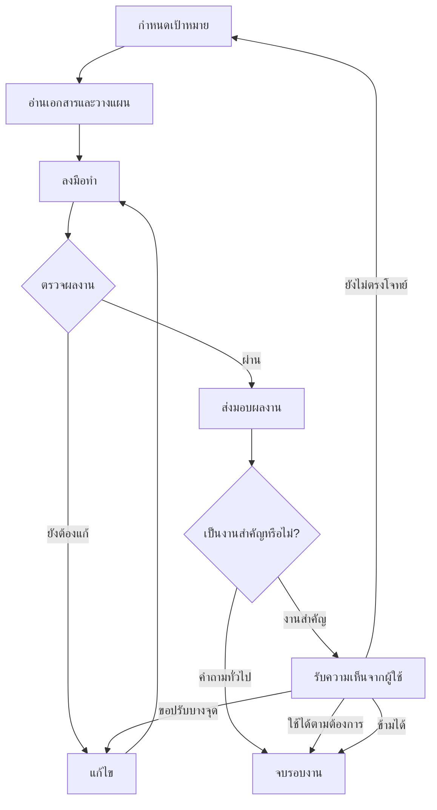

# AI-assisted Workflow

แนวทางทำงานร่วมกับ AI สำหรับการเรียน โปรเจ็ค และงานทั่วไป

เวลาทำงานกับ AI หลายเรื่อง เราอาจต้องเล่าข้อมูลเดิมซ้ำ หาไฟล์ล่าสุดไม่เจอ หรือกลับมาทำงานต่อแล้วจำไม่ได้ว่าค้างตรงไหน AI-assisted Workflow เสนอวิธีจัดเอกสารและลำดับงานให้ชัดเจน เพื่อให้คุณและผู้ช่วย AI เริ่มงานต่อได้สะดวกขึ้น

ในโครงการนี้มีคู่มือ ตัวอย่างการจัดไฟล์ และเครื่องมือสำหรับทดลองตาม สามารถเลือกใช้เฉพาะส่วนที่เหมาะกับงานของคุณ แล้วค่อยขยายเมื่อมีงานมากขึ้น

## ใช้ทำอะไรได้บ้าง

- **เรียนและเตรียมสอบ:** เก็บเอกสารประกอบการเรียน สรุป และแบบฝึกหัดแยกตามวิชา กลับมาอ่านทบทวนได้ง่าย
- **ทำรายงานและการบ้าน:** เก็บโจทย์ล่าสุด ต้นฉบับ ร่าง และฉบับที่ตรวจแล้วให้หาเจอในที่เดียว
- **ทำโปรเจ็ค:** ระบุเป้าหมาย ทดลองเป็นรอบ และเก็บผลแต่ละรอบไว้เปรียบเทียบ
- **ค้นคว้าเรื่องที่สนใจ:** รวบรวมคำอธิบาย แหล่งข้อมูล และประเด็นที่อยากศึกษาต่อ

เหมาะกับคนที่ใช้ AI ช่วยงานหลายเรื่อง และอยากจัดงานให้เป็นระเบียบโดยเริ่มจากไฟล์และโฟลเดอร์ที่คุ้นเคย

## วิธีทำงาน

เริ่มจากทำความเข้าใจโจทย์และอ่านเอกสารที่เกี่ยวข้อง จากนั้นลงมือทำ ตรวจผลงาน และปรับแก้จนตรงกับสิ่งที่ต้องการ



การตรวจผลงานขึ้นอยู่กับงานที่ทำ เช่น ตรวจคำตอบและการคำนวณ รันโค้ด หรืออ่านเอกสารฉบับที่จะส่ง หากแก้โจทย์หรือเปลี่ยนผลงาน ควรตรวจฉบับใหม่อีกครั้ง

หลังส่งมอบงานสำคัญ ผู้ใช้เลือกบอกได้ว่า **ใช้ได้ตามต้องการ**, **ขอปรับบางจุด** หรือ **ยังไม่ตรงโจทย์** เพื่อช่วยกำหนดสิ่งที่จะทำต่อ ข้ามการตอบได้ และคำถามทั่วไปไม่จำเป็นต้องถามความเห็นทุกครั้ง

## เริ่มใช้กับงานของคุณ

1. เลือกงานหนึ่งชิ้นที่กำลังทำ เช่น รายงานหนึ่งเรื่องหรือโปรเจ็คหนึ่งงาน
2. รวบรวมโจทย์ เอกสารต้นฉบับ และสิ่งที่ต้องทำให้เสร็จไว้ด้วยกัน
3. แยกต้นฉบับ โน้ต ร่าง และฉบับที่ตรวจแล้วให้ชัดเจน โดยใช้โฟลเดอร์เดิมต่อได้
4. ใช้ผู้ช่วย AI ที่อ่านไฟล์ในพื้นที่ทำงานได้ ให้ช่วยอ่านข้อมูล วางแผน และทำงานตามลำดับ

ดู [ตัวอย่างการจัดงาน](examples/README.md) และปรับ [คำแนะนำสำหรับผู้ช่วย AI](templates/AGENTS.example.md) ให้เข้ากับวิธีทำงานของคุณ

ตัวอย่างคำขอสำหรับเริ่มทำรายงาน:

```text
ช่วยอ่านโจทย์และเอกสารในโฟลเดอร์นี้ แล้วสรุปว่าต้องทำอะไรบ้าง
วางโครงรายงานก่อน จากนั้นเขียนร่างโดยอธิบายให้อ่านเข้าใจง่าย
เมื่อเสร็จแล้ว ตรวจเนื้อหาให้ครบตามโจทย์ และบอกส่วนที่ยังต้องแก้
เก็บเอกสารต้นฉบับไว้ และระบุให้ชัดว่าควรเปิดอ่านไฟล์ฉบับไหน
```

## ลองตัวอย่าง

ดาวน์โหลดโครงการผ่าน **Code → Download ZIP** แล้วแตกไฟล์ หรือใช้คำสั่ง:

```sh
git clone https://github.com/panithan1991/ai-assisted-workflow.git
cd ai-assisted-workflow
```

ใช้ Python 3.10 ขึ้นไป เปิดเทอร์มินัลในโฟลเดอร์โครงการ แล้วรันคำสั่งต่อไปนี้ได้โดยไม่ต้องติดตั้งแพ็กเกจเพิ่ม:

```sh
python -B tools/check_blueprint.py
python -B tools/demo_workflow.py
```

คำสั่งแรกตรวจความครบถ้วนของตัวอย่างและลิงก์เอกสาร ส่วนคำสั่งที่สองสาธิตงานสมมติตั้งแต่รับโจทย์ ตรวจผลงาน ปรับตามโจทย์ที่เปลี่ยน ไปจนถึงจำลองการยืนยันส่งงาน

อ่าน [คำอธิบายตัวอย่างทีละขั้น](docs/walkthrough.md) ประกอบได้ ข้อความ `EXPECTED REJECTION` ในผลสาธิตหมายถึงโปรแกรมหยุดกรณีที่ควรหยุด เช่น ไฟล์ถูกแก้หลังตรวจแล้ว

## อ่านเพิ่มเติม

| เอกสาร | เหมาะสำหรับ |
|---|---|
| [วิธีทำงาน](docs/workflows.md) | ดูตัวอย่างการเรียน ทำงาน และกลับมาทำต่อ |
| [เริ่มนำไปใช้](docs/adoption-plan.md) | ปรับใช้กับโฟลเดอร์และงานที่มีอยู่ |
| [การตรวจงานและรับความเห็น](docs/feedback-loop.md) | ทำความเข้าใจการปรับงานหลังส่งมอบ |
| [โครงสร้างของโครงการ](docs/architecture.md) | ศึกษาว่าแต่ละส่วนเชื่อมกันอย่างไร |
| [รูปแบบข้อมูล](docs/data-contracts.md) | ปรับตัวอย่างหรือพัฒนาเครื่องมือต่อ |
| [เหตุผลในการออกแบบ](docs/decisions.md) | อ่านที่มาของแนวทางที่เลือกใช้ |
| [แหล่งอ้างอิง](docs/references.md) | อ่านเอกสารเครื่องมือที่เกี่ยวข้อง |

## License

ใช้ [MIT License](LICENSE) สามารถนำไปใช้ แก้ไข และแจกจ่ายต่อได้ รวมถึงใช้เชิงพาณิชย์ โดยคงประกาศลิขสิทธิ์และข้อความ License ไว้ตามเงื่อนไข
