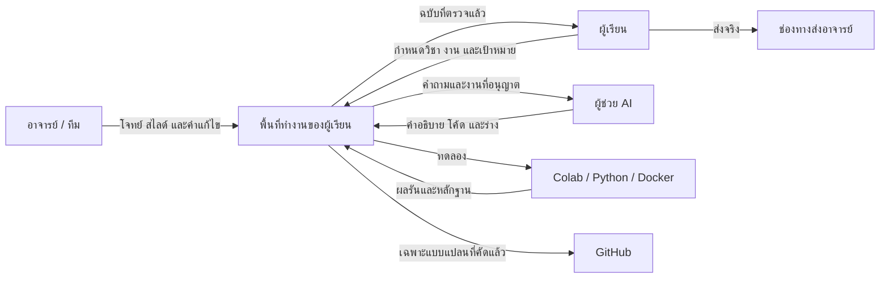
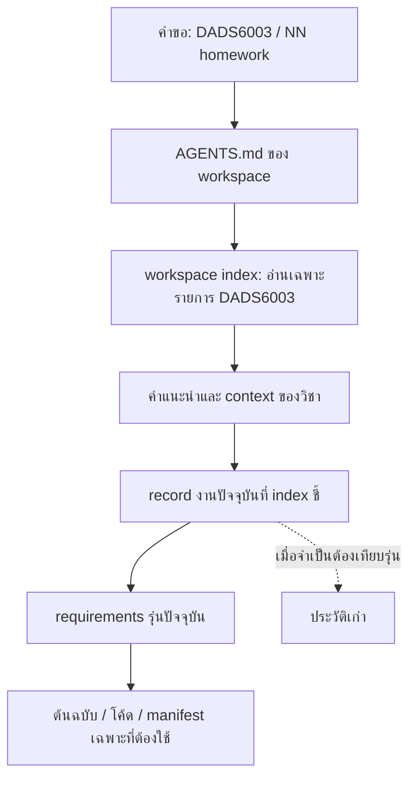

# Architecture

## 1. ขอบเขตและผลที่ต้องได้

พื้นที่ทำงานรองรับวงจร เรียน → อธิบาย → ทดลอง → เขียนงาน → ตรวจ → เตรียมส่ง และกลับมาทำต่อภายหลังได้ การออกแบบครอบคลุมหลายวิชาและเครื่องมือ AI ที่มีอยู่ ไม่จำเป็นต้องมีฐานข้อมูลหรือบริการกลางเพื่อเริ่มใช้งาน

ผลที่ตรวจสอบได้:
- เริ่มงานจากรหัสวิชาและรหัสงาน แล้วค้นพบข้อกำหนดล่าสุด ต้นฉบับ environment และไฟล์ปัจจุบัน
- คำแก้ไขของอาจารย์ทำให้การตรวจฉบับเดิมหมดอายุอย่างชัดเจน
- แยกความพร้อมของ GPU/driver ออกจากความพร้อมของ PyTorch ในแต่ละ environment
- ระบุไฟล์ที่เตรียมส่งได้ โดยไม่อนุมานว่าได้ส่งงานแล้ว
- ย้าย configuration และเอกสารขึ้น GitHub ได้โดยไม่พาข้อมูลส่วนตัวขึ้นไป

## 2. System context



การเชื่อมในภาพเป็นเส้นทางการทำงานที่ออกแบบไว้ ไม่ได้หมายความว่าแอปเหล่านี้เชื่อมบัญชี อ่านไฟล์ร่วมกัน หรือซิงก์ความจำอยู่แล้ว

## 3. ส่วนประกอบและความรับผิดชอบ

| Component | หน้าที่ | ข้อมูลเข้า | ผลลัพธ์ |
|---|---|---|---|
| Workspace index | ชี้ว่าวิชาและงานอยู่ที่ใด | รหัสวิชา/รหัสงาน | ที่อยู่ context และจุดเปิดงาน |
| Context loader | เลือกอ่านข้อมูลเฉพาะงาน | index + คำขอปัจจุบัน | ชุดบริบทขนาดเล็ก |
| Task controller | วางลำดับงานและติดตามสถานะ | บริบท + ข้อกำหนด | แผนย่อย สถานะ และงานที่ยังค้าง |
| Source registry | เก็บต้นทางและรุ่นของเอกสาร | URL/ไฟล์ + checksum เมื่อมี | ต้นฉบับที่อ้างกลับได้ |
| Execution router | เลือกว่าจะรันที่ใด | ประเภทงาน + environment registry | Colab / local environment / Docker |
| AI adapter | ใช้เครื่องมือที่เหมาะกับงาน | คำขอ + ขอบเขตไฟล์ | คำอธิบาย โค้ด หรือร่าง |
| Verification | ตรวจผลให้ตรงกับข้อกำหนดรุ่นปัจจุบัน | ผลงาน + ข้อกำหนด | หลักฐานตรวจผ่าน/ไม่ผ่าน |
| Artifact registry | ระบุฉบับพร้อมส่งและแหล่งสร้าง | ไฟล์ + checksum + ผลตรวจ | manifest ของฉบับที่เลือก |
| History and backup | เก็บเหตุการณ์แก้ไขและเวอร์ชันก่อนหน้า | เหตุการณ์สำคัญ | ประวัติและสำเนาที่กู้คืนได้ |

ระยะแรก Task controller, Context loader และ Execution router เป็นขั้นตอนที่ผู้เรียนกับ Codex ทำตามเอกสาร ยังไม่สร้าง daemon หรือ agent orchestration เพิ่ม

## 4. อ่านบริบทตามงาน



AGENTS.md ใช้เก็บวิธีทำงานที่คงที่ ส่วนสถานะล่าสุดและเนื้อหาเอกสารเก็บในไฟล์แยก ไม่ยัดสไลด์ ตารางเรียน หรือ log ทั้งหมดไว้ในคำสั่งประจำโปรเจ็ค

เมื่อนำไปใช้กับโฟลเดอร์เก่า สามารถเก็บ record ปัจจุบันใน _workspace/state/ แล้วใช้ index ชี้ไปหาได้ โดยถือ metadata เก่าเป็นประวัติ ไม่ให้สคริปต์เดิมที่เขียน assignment-context.json ทับข้อกำหนดปัจจุบัน ตัวอย่างในชุดนี้ใช้ path สั้นเพื่ออ่านง่าย หลักสำคัญคือมี record หลักเพียงชุดเดียวต่อหนึ่งงาน

เมื่อเปิด Codex ที่ root ของ workspace ให้คำสั่ง root ระบุว่าต้องอ่านคำแนะนำของวิชาที่เกี่ยวข้องด้วย ไม่สมมติว่าไฟล์ AGENTS.md ในโฟลเดอร์ลูกทุกวิชาจะถูกโหลดเอง

พฤติกรรมการอ่าน AGENTS.md และการเรียงลำดับคำแนะนำอ้างอิงจาก [official OpenAI documentation](https://learn.chatgpt.com/docs/agent-configuration/agents-md)

## 5. โครงสร้างเป้าหมาย

```text
workspace/
├── AGENTS.md                    # วิธีทำงานร่วมกันและวิธีเลือก context
├── _workspace/
│   ├── index.json               # ที่อยู่ของแต่ละวิชา ไม่เก็บโจทย์ซ้ำ
│   ├── environments.json        # Python/kernel/Colab/Docker ที่ยืนยันแล้ว
│   ├── state/                   # record ปัจจุบันเมื่อรับระบบมาใช้กับไฟล์เดิม
│   │   ├── courses/
│   │   └── assignments/
│   ├── templates/
│   └── blueprints/
├── Inbox/                       # เอกสารที่ยังไม่ได้ระบุวิชา/งาน
├── DADS6001/                    # ใช้ชื่อและที่อยู่เดิมต่อได้
├── DADS6003/
│   ├── AGENTS.md
│   ├── course-context.json       # ตัวอย่าง; ใช้ index ระบุ record หลักเมื่อมีรุ่นเก่า
│   ├── Lectures/                # ต้นฉบับอาจารย์
│   ├── Notes/                   # บันทึกความเข้าใจ
│   ├── Projects/                # โปรเจ็คใหม่; โปรเจ็คเดิมใช้ path เดิมและลงสารบัญ
│   ├── Labs/
│   │   └── pytorch-intro/
│   │       ├── notebooks/
│   │       ├── src/
│   │       ├── outputs/
│   │       └── requirements.txt
│   └── Assignments/
│       └── NN_homework/
│           ├── assignment-context.json
│           ├── original/
│           ├── src/
│           ├── working/
│           ├── submission/
│           └── archive/
├── dads5001/                    # รักษา week10/multipages ที่อ้างอยู่เดิม
└── Tools/System/                # เครื่องมือดูแลเครื่อง แยกจากบทเรียน
```

โฟลเดอร์ที่เสนอใช้กับงานใหม่ได้ก่อน งานเดิมยังอยู่ตำแหน่งเดิมแล้วใช้ index ชี้เข้าไป การย้ายต้องมีแผนที่ old path → new path และตรวจลิงก์/ไฟล์หลังย้าย

## 6. บทบาทเครื่องมือ

| เครื่องมือ | บทบาทที่เสนอ | เมื่อใดจึงใช้ |
|---|---|---|
| Codex / แชตหลัก | ผู้ประสานงานและผู้แก้ไฟล์หลัก | เรียน อธิบาย เขียนโค้ด ทำรายงาน และตรวจ |
| Colab | สภาพแวดล้อมทดลองระหว่างเรียน | ทำตาม Notebook ของอาจารย์และใช้ GPU บน Cloud |
| Python แยก environment | รันทดลองซ้ำในเครื่อง | ต้องการความคงที่ของแพ็กเกจและงานต่อเนื่อง |
| Docker | แยกบริการและ dependency | MongoDB หรือโปรเจ็คที่มีบริการประกอบ |
| Ollama | บริการโมเดลในเครื่อง | เมื่อต้องการ inference ด้วยโมเดลที่ติดตั้งไว้ |
| AnythingLLM | ช่องค้นเอกสารที่เลือกเข้าไป | เมื่อต้องค้นหลายไฟล์และยังต้องอ้างกลับต้นฉบับ |
| Hermes | งานปฏิบัติซ้ำที่กำหนดชัด | เลือกใช้เป็นงาน ๆ พร้อมขอบเขตที่ผู้เรียนกำหนด |
| OpenCode | เครื่องมือเขียนโค้ดอีกทางหนึ่ง | เมื่อเลือกใช้แทนผู้แก้ไฟล์หลักในงานนั้น |
| AI Scientist | ทดลองงานวิจัยเป็นโครงการเฉพาะ | โจทย์ที่ต้องทดลอง วิเคราะห์ และจัดทำงานวิจัย |
| LaTeX/PDF tools | ผลิตและตรวจเอกสาร | รายงานและการบ้านที่มีสูตรหรือข้อกำหนดรูปแบบ |

ไม่ได้กำหนดให้ทุกเครื่องมือต้องเปิดพร้อมกัน และไม่ได้เปลี่ยน provider/model ของเครื่องมือใดจากเอกสารนี้

## 7. Environment contract

แต่ละ environment ระบุ:
- identifier, ประเภท และวิธีเปิด
- interpreter path หรือชื่อ kernel ที่ยืนยันแล้ว
- แพ็กเกจ/lockfile ของงาน
- วันที่และหลักฐานตรวจว่า import และรันตัวอย่างสำเร็จ
- ผลตรวจ CUDA ของ environment นั้น แยกจาก GPU และ driver ของเครื่อง

ก่อนรัน local ให้ใช้ interpreter ที่ระบุใน registry โดยตรง หรือ kernel ที่จับคู่ไว้ ไม่ใช้ PATH เป็นหลักฐานว่าเป็น environment ที่ถูกต้อง

CUDA ใน driver ไม่ได้ยืนยันว่า PyTorch ที่ติดตั้งเป็นรุ่น CUDA และ CUDA ของ Colab เป็นของ runtime บน Cloud

## 8. ขอบเขตข้อมูล

| ประเภท | เจ้าของข้อมูล/ที่เก็บ |
|---|---|
| เนื้อหาจากอาจารย์ | original/Lectures พร้อม source reference |
| ข้อกำหนดล่าสุด | current_requirements ใน assignment context |
| รูปแบบการเขียนเฉพาะงาน | assignment context; กฎทั่วไปอยู่ใน AGENTS.md |
| บทเรียนปัจจุบัน | course context |
| ไฟล์ฉบับที่เลือก | artifacts และ revision ใน assignment context |
| ข้อกำหนดและฉบับเก่า | change history / archive |
| credentials และตำแหน่งจริงของเครื่อง | configuration ส่วนตัวที่ไม่เข้า Git |
| บันทึกการส่งงาน | submission evidence เมื่อส่งจริงแล้ว |

## 9. ความล้มเหลวและการกลับมาทำต่อ

- Runtime ใช้งานไม่ได้: บันทึก environment ที่ล้มเหลว ใช้ตัวเลือกที่เตรียมไว้ เช่น Colab โดยไม่แก้ environment อื่นแบบเหมารวม
- ข้อกำหนดเปลี่ยน: เพิ่ม requirements revision ยกเลิกความพร้อมของฉบับเดิม และตรวจใหม่
- มีหลายไฟล์ชื่อ final: ใช้ artifact revision และ checksum จาก registry
- แชตใหม่: เริ่มจาก index/context ล่าสุด ไม่ต้องอ่าน log ทั้งโปรเจ็ค
- งานหลายเครื่องมือ: ให้ผู้แก้ไฟล์หนึ่งรายรับผิดชอบต่อช่วงงาน ส่งต่อผ่านไฟล์และสถานะ
- backup: เก็บ source, metadata, requirements และฉบับส่ง ส่วน cache/dependency ที่ติดตั้งใหม่ได้แยกออกตามนโยบายสำรอง
