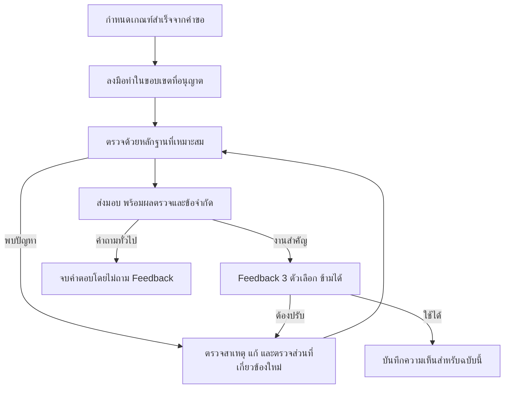

# วงจรตรวจงานและ Feedback

วงจรนี้ใช้กับชิ้นงานสำคัญ เช่น รายงาน โค้ดที่แก้เสร็จ คำตอบหรือสรุปเพื่อสอบที่ขอเป็นชิ้นงาน การจัดโฟลเดอร์ และ milestone ของโปรเจ็ค ไม่ถามหลังคำถามทั่วไป คำอธิบายสั้น ข้อความสถานะ หรือแต่ละขั้นระหว่างทำงาน

การใช้งานเป็นกติกาที่ผู้ใช้กับผู้ช่วยทำตามในแชต ผู้ช่วยต้องอ่านนโยบายที่เปิดใช้ในพื้นที่ของตน ไม่มี daemon หรือการฝึกโมเดลเบื้องหลัง และไม่ทำให้ความจำซิงก์ข้ามแอปเอง



## ก่อนและระหว่างทำงาน

สรุปเกณฑ์จากคำขอปัจจุบันและข้อกำหนดที่ยืนยันแล้ว หากชัดเจนอยู่แล้วไม่ต้องถามซ้ำ ตรวจตามสิ่งที่งานนั้นต้องพิสูจน์ เช่น ผลคำนวณและการแปลผลสำหรับงานสถิติ การรันและผลลัพธ์สำหรับโค้ด จำนวนหน้าและภาพหน้าที่แสดงผลจริงสำหรับรายงาน ลิงก์และแฮชต้นฉบับสำหรับการจัดไฟล์

ผลตรวจใช้ ผ่าน / ไม่ผ่าน / ยังไม่ได้ตรวจ / ไม่เกี่ยวกับงานนี้ พร้อมระบุสิ่งที่ยังไม่ทราบ ไม่ถือว่ามีไฟล์อยู่หรือ compile ผ่านแล้วเนื้อหาถูกต้องทั้งหมด

แก้ข้อผิดพลาดที่ยืนยันได้ภายในขอบเขตเดิมโดยไม่ขออนุญาตซ้ำ หากต้องเปลี่ยนโจทย์หรือทำสิ่งที่ยังไม่ได้อนุญาต ให้แจ้งเหตุผลและรอข้อมูล/การอนุญาตที่จำเป็น การให้ Feedback ไม่อนุญาตรันโมเดลรอบใหม่หรือส่งข้อมูลไปบริการภายนอกแทนเจ้าของงาน

## หลังส่งมอบงานสำคัญ

ส่งมอบผลที่เปิดดูหรือตรวจได้ก่อน แล้วถามครั้งเดียวสำหรับฉบับนั้น:

> งานชิ้นนี้ตรงกับที่ต้องการหรือยังครับ? ข้ามได้

| ตัวเลือก | รหัส | สิ่งที่ทำต่อ |
|---|---|---|
| ใช้ได้ตามต้องการ | accepted | บันทึกคำตอบสำหรับฉบับที่ประเมิน โดยคงผลตรวจและสิทธิ์เดิม |
| ขอปรับบางจุด | adjust | ถ้ามีรายละเอียดให้แก้ตามนั้น ถ้ายังไม่ชัดให้ถามประเด็นหลักหนึ่งข้อ |
| ยังไม่ตรงโจทย์ | off_target | ทบทวนเป้าหมายและจุดที่คลาดเคลื่อนก่อนทำต่อ |

ใช้ตัวเลือกในแชตเมื่อเครื่องมือรองรับ หากไม่มีให้แสดงข้อความสามข้อและรับเลขหรือข้อความตอบกลับ ไม่ต้องติดตั้ง UI ใหม่

หากผู้ใช้บอกความเห็นเกี่ยวกับฉบับนั้นชัดเจนแล้ว ไม่ต้องถามฟอร์มอีก ไม่มีคำตอบคง pending ไม่ถือว่า accepted ไม่ทวงหรือสร้าง reminder เมื่อผู้ใช้เปลี่ยนเรื่อง หากผู้ใช้ข้ามชัดเจนให้ใช้ skipped

## แปลความเห็นเป็นงานที่ต้องแก้

| ประเภท | ตัวอย่าง | การตอบสนอง |
|---|---|---|
| ข้อผิดพลาด | คำนวณหรือแปลผลผิด | ตรวจหลักฐาน แก้ และเพิ่มการตรวจเมื่อช่วยป้องกันข้อผิดพลาดเดิม |
| ไม่ตรงข้อกำหนด | จำนวนหน้าหรือไฟล์ผิด | แก้ให้ตรงข้อกำหนดปัจจุบัน |
| ความชอบ | อยากสั้นลงหรือเพิ่มตัวอย่าง | ปรับงานนี้ก่อน ไม่ยกเป็นกฎทุกวิชาโดยอัตโนมัติ |
| โจทย์เปลี่ยน | เพิ่มหัวข้อหรือเปลี่ยนข้อมูล | เพิ่มรุ่นข้อกำหนด ยกเลิกความพร้อมที่อิงฉบับเดิม และตรวจใหม่ |

ข้อกล่าวว่าเนื้อหาผิดยังต้องตรวจหลักฐาน ไม่แก้ข้อเท็จจริงให้ผิดเพื่อให้ได้คำตอบว่าพอใจ เมื่อแก้ไฟล์ที่เลือกต้องเพิ่มรุ่นผลงานและตรวจใหม่ตาม contract เดิม

## บันทึกโดยไม่รับรองเกินหลักฐาน

ผูก Feedback กับ delivery_id, task_id, รุ่นและ hash ของข้อกำหนด รวมถึงรุ่นและ hash ของชิ้นงาน สำหรับคำตอบในแชตใช้ hash ของเนื้อหาที่ส่ง ผู้บันทึกสร้าง snapshot จากสิ่งที่ส่งมอบจริง คำตอบที่กำกวมต้องยืนยันว่าหมายถึงฉบับใดก่อนบันทึก

Feedback เก่ายังคงเป็นประวัติเมื่อมีฉบับใหม่ แต่ห้ามถ่าย acceptance มาให้ฉบับใหม่ ผลตรวจ ความคิดเห็นผู้ใช้ และหลักฐานส่งจริงเป็นคนละสถานะ และ Feedback ไม่เป็น field บังคับของ assignment

เก็บความเห็นจริงในพื้นที่ส่วนตัวเท่านั้น ตัวอย่างใน Blueprint เป็นข้อมูลสมมติ การจดบทเรียนช่วยให้ผู้ช่วยที่อ่านบริบทครั้งถัดไปปรับวิธีทำงานได้ ไม่ได้แปลว่ามีการปรับน้ำหนักโมเดลหรือเก็บทุกแชตถาวร

## ตัวชี้วัดเริ่มต้น

เก็บผลตรวจฉบับแรก จำนวนรอบที่แก้ และเหตุที่แก้ โดยแยกความผิดพลาดออกจากความชอบและการเปลี่ยนโจทย์ หากรายงานความพอใจให้นับเฉพาะงานที่มีคำตอบชัดเจน พร้อมจำนวนงานที่ตอบและยัง pending ไม่แต่งเปอร์เซ็นต์จากการไม่ตอบ

## ทดลองตรวจ contract

[ตัวอย่าง pending](../examples/feedback/pending.json) ไม่มีคำตอบผู้ใช้ ส่วน tests ใช้คำตอบจำลองเพื่อตรวจกรณีต่อไปนี้:

```sh
python -B tools/check_blueprint.py
python -B -m unittest discover -s tests -p test_feedback.py -v
```

ตัวตรวจต้องยอมให้ข้าม ไม่ย้ายความพอใจไปอีกฉบับ และไม่เปลี่ยนผลตรวจ failed หรือสิทธิ์ดำเนินการเพียงเพราะผู้ใช้เลือก accepted ดู [รายละเอียดรูปแบบข้อมูล](data-contracts.md)
