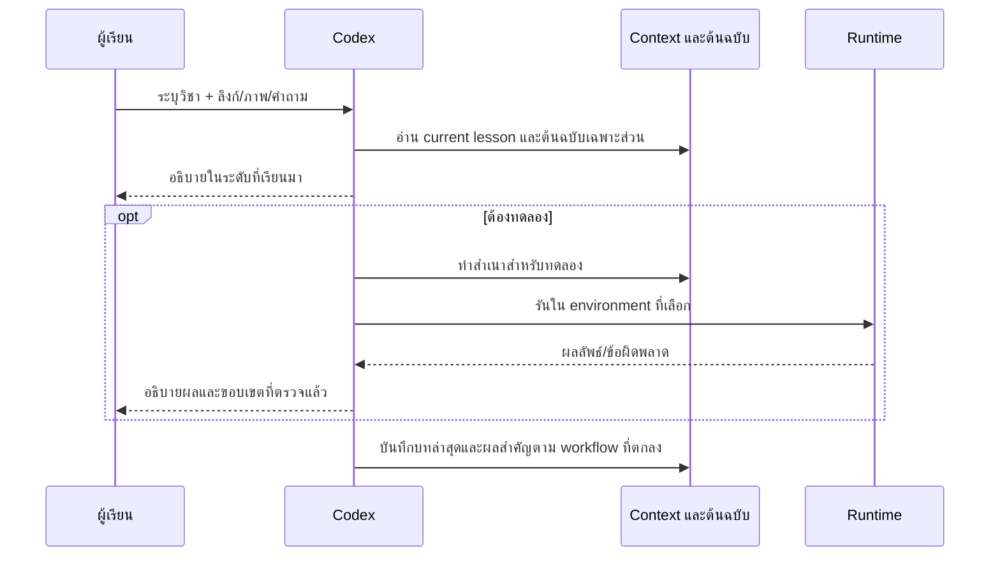
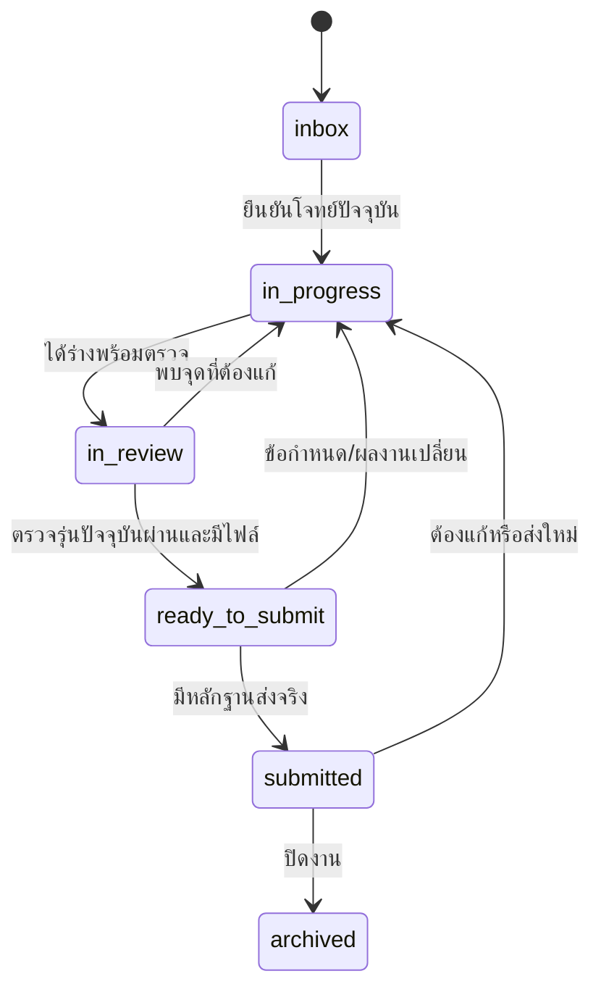

# Workflows

เริ่มจาก [ตัวอย่างทีละขั้นที่รันได้](walkthrough.md) หากต้องการเห็นการเปลี่ยนสถานะและกรณีที่ตัวตรวจปฏิเสธด้วยไฟล์สมมติ

## เรียนประจำวัน

อินพุตที่เพียงพอ เช่น “วันนี้ DADS6003 ต่อเรื่อง Tensor ใน Notebook นี้” เมื่อมีเพียงคำถามอธิบาย ไม่ต้องติดตั้งแพ็กเกจ เปิดบริการ หรือรัน Notebook ทั้งเล่ม

ผลเก็บแยกเป็นต้นฉบับ สำเนาที่แก้ บันทึกความเข้าใจ และผลรัน ยึดลำดับบทที่ผู้เรียนยืนยัน ไม่เดาว่าเรียนจบแล้วจากการเห็นหัวข้อใน Notebook

## ทำการบ้านและรายงาน

### ลำดับการทำงาน

1. **รับโจทย์:** เก็บ original, source และวันที่ ระบุคำแก้ไขที่อาจารย์ยืนยันแล้ว
2. **กำหนดงานปัจจุบัน:** บันทึก current_requirements พร้อม revision และเกณฑ์ตรวจ เช่น จำนวนหน้า ทศนิยม และขอบเขตการคำนวณ
3. **ลงมือทำ:** สร้างโค้ดหรือเอกสารใน src/working ระบุ environment และข้อมูลเข้าที่ใช้
4. **ตรวจ:** ตรวจการคำนวณ/ผลรัน และตรวจรูปแบบเอกสารตามงาน บันทึก JSON หลักฐานที่อ้างถึง requirements revision, artifact revision, hash ของข้อกำหนด และ hash ของไฟล์ที่ตรวจ
5. **เลือกฉบับพร้อมส่ง:** เก็บไฟล์ใน submission ลงรายการไฟล์พร้อม checksum และบันทึกผลตรวจ
6. **ส่งมอบและรับความเห็น:** สรุปสิ่งที่ตรวจแล้วและข้อจำกัด ถาม Feedback ครั้งเดียวต่อฉบับเมื่อเป็นงานสำคัญ ให้ข้ามได้ ไม่บังคับ Feedback เพื่อรับรองสถานะทางเทคนิค ดู [วงจร Feedback](feedback-loop.md)
7. **ส่งจริง:** เปลี่ยนเป็น submitted หลังผู้เรียนยืนยันพร้อมหลักฐาน เช่น ใบตอบรับหรือข้อมูลการส่ง ไม่อนุมานจากการมี PDF หรือการตอบว่าใช้ได้

## เมื่ออาจารย์แก้โจทย์

ตัวอย่าง: จากคำนวณอนุพันธ์ 21 ตัว เป็น 3 ตัวบนสายที่กำหนด

- เก็บข้อความเดิมใน history และเพิ่ม requirements revision
- current_requirements เหลือข้อกำหนดปัจจุบัน 3 ตัว
- บันทึกว่าข้อกำหนดใหม่นี้มาแทนข้อใด
- ผลตรวจของ revision เก่าใช้รับรองฉบับปัจจุบันไม่ได้
- หากลืมเพิ่ม revision แต่แก้เนื้อหาข้อกำหนดแล้ว ตัวตรวจยังพบจาก requirements_sha256 ที่ไม่ตรง
- ถ้าเคย ready_to_submit ให้กลับ in_progress แล้วทำและตรวจใหม่

ไม่ใช้การอ่านข้อความเก่าแล้วเดาว่าคำสั่งใดใหม่กว่า เมื่อแก้ข้อกำหนด ให้ปรับ current state กับ history ในชุดงานเดียวกัน

ตัวตรวจรายงานความไม่สอดคล้องแบบอ่านอย่างเดียว ไม่เขียนสถานะกลับให้เอง ผู้ใช้หรือเครื่องมือที่รับผิดชอบต้องเปลี่ยนสถานะกลับ in_progress และทำงานกับตรวจใหม่

## กลับมาทำงานต่อ

อ่านเฉพาะ:
1. workspace index เพื่อหาที่อยู่
2. คำแนะนำวิชาและ course context
3. assignment context เมื่อเป็นงานส่ง
4. current_requirements, artifact revision, หลักฐานตรวจ และงานที่ยังค้าง
5. original/source เฉพาะที่ต้องตรวจยืนยัน

หากข้อมูลกำกับขัดกัน ให้ใช้คำสั่งปัจจุบันของผู้เรียนและหลักฐานคำแก้ไขที่ยืนยันแล้วแก้ current state ก่อนทำงานต่อ ไม่ใช้ประวัติทั้งแชตแทนข้อกำหนดปัจจุบัน

## เลือกเครื่องมือและ runtime

| งาน | เส้นทางเริ่มต้นที่เสนอ |
|---|---|
| อธิบายบทเรียน | แชต + ต้นฉบับเฉพาะส่วน |
| ทำตามอาจารย์ใน Colab | สำเนา Notebook ใน Colab |
| ทดลอง local | environment ที่ระบุและตรวจ import/ตัวอย่างขั้นต่ำ |
| ฐานข้อมูลทดลอง | Docker หรือ Atlas ตามโจทย์ แยกข้อมูลตัวอย่าง |
| รายงานสูตรและกราฟ | source ที่แก้ได้ → LaTeX → PDF → ตรวจหน้า |
| ค้นหลายเอกสาร | เลือกเอกสารเข้าระบบค้น แล้วเปิดต้นฉบับยืนยันข้อความ |
| งานวิจัยอัตโนมัติ | โครงการ AI Scientist แยก พร้อมเป้าหมายและผลทดลอง |

การเลือกเส้นทางไม่ใช่การรับประกันว่า environment พร้อม ต้องตรวจสถานะของงานนั้น

## ส่งต่อระหว่างเครื่องมือ AI

ผู้รับงานต้องได้รับ scope, current context, input paths, output path และ acceptance criteria จากผู้รับผิดชอบหลัก กำหนดผู้แก้ไฟล์หลักหนึ่งรายต่อช่วงงาน เมื่อส่งต่อให้บันทึกสิ่งที่เปลี่ยน ผลตรวจ และงานค้าง ก่อนอีกเครื่องมือเริ่มเขียนไฟล์เดียวกัน

## แบ่งปันความรู้บน GitHub

1. ใช้ repository สำหรับแบบแปลน/โค้ดตัวอย่างโดยเฉพาะ
2. คัดเอกสารและตัวอย่างที่เผยแพร่ได้ โดยไม่คัด workspace ส่วนตัวทั้งชุด
3. ตรวจ JSON ตัวอย่าง ลิงก์เอกสาร และ workflow tests
4. เลือกชื่อ repository และ visibility; ชุด Blueprint นี้ใช้ [MIT License](../LICENSE) โดยตรวจขอบเขตสิทธิ์ของเนื้อหาที่จะรวมด้วย
5. รีวิวชุดไฟล์ที่จะเผยแพร่ แล้วจึงสร้าง remote/push ตามคำสั่งเจ้าของงาน
